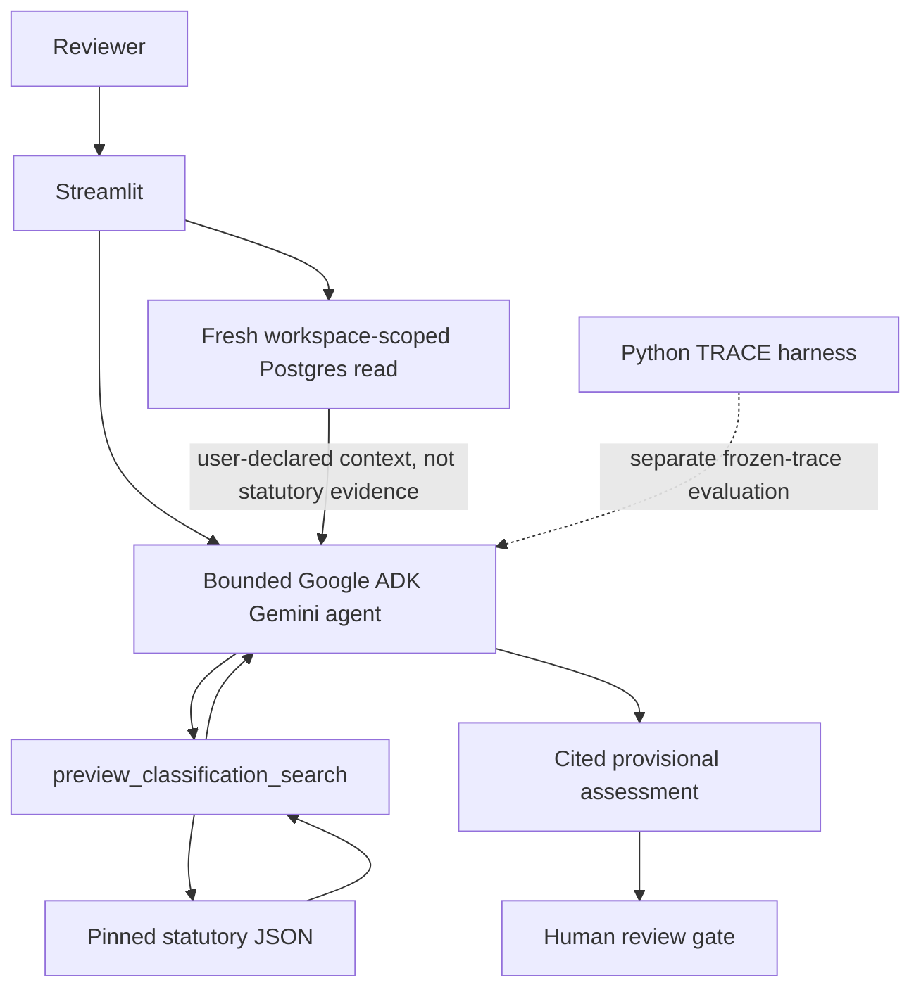

# AeacusAI — EU AI Act Risk Classification Copilot

AeacusAI turns a plain-language AI system description into a **cited, provisional** EU AI Act classification reading, with missing facts called out and a human review gate before anything is recorded.

This is a classification-subset preview against a pinned Article 6 / Annex III / Article 113 corpus. It is not a full-Act review and does not grant compliance, conformity, or “not prohibited” conclusions.

Built for the [Maven AI Engineering Bootcamp](https://maven.com/) with TAI Labs.

**Live demo:** [https://aeacusai-demo.onrender.com/](https://aeacusai-demo.onrender.com/)
**Screen recording:** [Google Drive](https://drive.google.com/file/d/1tuAONquwSadGGAQs6FBKCw4xi1425tgP/view?usp=sharing)
**Golden-path observation:** [reports/demo_golden_path_20261031.md](reports/demo_golden_path_20261031.md)
Video sharing and playback permissions have not been independently verified.

---

## The problem

EU AI Act classification is high-stakes and easy to get wrong in a chatbot: the model may invent articles, skip exceptions, or treat a hiring-filter as “safe” because a human clicks last. Reviewers need a bounded, evidence-backed draft they can inspect — retrieved statute text, explicit unknowns, and a recording step that the model cannot skip.

## What AeacusAI does

On **Assessment**, the reviewer loads the recruitment example (or types a description) and clicks **Run assessment**. A single Google ADK agent chooses a search query, calls `preview_classification_search` over local statutory JSON, observes the returned child passages and parent context, and drafts a cited finding. The UI shows THINK / ACT / OBSERVE / FINAL, expandable source text, and a **Human review** panel. Recording requires an explicit **Approve and record**. Opening the app does not write project memory, and the model cannot approve a review.

If a private workspace is connected, **Run assessment** also does a fresh Postgres read of three user-declared fields and supplies them as untrusted application context. That path is optional. The verified Demo Day run used the no-workspace recruitment example.

---

## Architecture

Memory is application-supplied context. It is not statutory evidence. TRACE is a separate evaluation layer over frozen traces, not part of a live click.



---

## Stack

Demonstrated path:

| Layer | What is actually used |
| --- | --- |
| UI | Streamlit (`streamlit_app.py`) |
| Hosting | Render (`aeacusai-demo`) |
| Agent | Google ADK, one `aeacus_preview_agent`, no sub-agents |
| Model | Configured Gemini (`gemini-3.8-flash` by default) |
| Retrieval | Local lexical search over pinned statutory JSON |
| Memory | Railway PostgreSQL, schema `aeacus_memory` |
| Eval | Python TRACE harness over frozen JSONL traces |
| Limits | `max_llm_calls=8`, 90-second timeout |

OpenAI embeddings and Pinecone belong to a **separate** `aeacus_review_agent` in this package. They are not used on the demonstrated preview path and are not required to run the live demo.

---

## TRACE evaluations

Twenty original live parent traces (`week4_adk_preview_v1`) were frozen and annotated against taxonomy F1–F4. Labels are AI-assisted judgments accepted by Lily. They are not independent expert legal adjudication.

| Result | What it measures | What it is not |
| --- | --- | --- |
| **8/20** overall pass | Trace passed all four taxonomy categories | Assessment accuracy, legal quality, or compliance |
| F1 **5** / F2 **5** / F3 **2** / F4 **1** | Distinct category failure counts | A summed “13 failures” score (12 distinct traces failed at least one category) |
| Timing check **18/20 → 20/20** | `deferred_date_qualifications_v1` after `aeacus.timing_scope.v1` replay | A new live-run improvement or an overall-accuracy gain |
| F1 prompt experiment **5/20 → 5/20** | Instruction-only candidate, then rejected | A shipped prompt change |
| Judges **0/5** TPR | Frozen v1 and v2 on held-out validation | A release gate |

The timing formatter is an application-layer replay of saved traces: raw model text failed TRACE-S02 and TRACE-S20; delivered text passed 20/20. F1 and original TRACE-S19 (6 search acts vs a budget of 2) are unchanged by that renderer.

Evidence: [reports/week4_codify_baseline.md](reports/week4_codify_baseline.md), [reports/week4_timing_repair_eval.md](reports/week4_timing_repair_eval.md), [reports/week4_f1_candidate_collection.md](reports/week4_f1_candidate_collection.md), [reports/week4_f1_judge_validation.md](reports/week4_f1_judge_validation.md), [WEEK4_SUBMISSION.md](WEEK4_SUBMISSION.md).

---

## Project memory

The **Project memory** workspace stores user-declared context for a private workspace. It is not statutory evidence, not a classification, and not human approval. The model cannot write memory or approve a review.

1. **What is stored.** Only `project_name`, `declared_actor_role` (`provider` / `deployer` / `both` / `unknown`), and `preferred_response_language` (`English` / `French`). Source is always `user_declared`. Credentials, tool dumps, legal conclusions, and approvals are rejected.

2. **When it is written.** Only after an explicit UI confirmation and **Save project memory**. The application supplies `application_confirmed_user`. Model answers, retrieved documents, and the review register cannot write memory.

3. **Where it is stored.** External Postgres (`AEACUS_MEMORY_DATABASE_URL`, schema `aeacus_memory`). If that store is unconfigured or unavailable, the UI returns `memory_unavailable`. Streamlit session state and local files are not a substitute.

4. **How it is retrieved.** **Recall saved memory** reads Postgres for the connected workspace. A later session that enters only the private workspace code can recall the same facts. Clearing a tab is not a new process. **Run assessment** performs its own fresh `list_facts` read and does not reuse the recalled session list.

5. **When it is forgotten.** **Delete saved field** removes that field, including superseded history. Active facts also stop being returned once `expires_at` has passed (default **180 days**, `AEACUS_MEMORY_TTL_DAYS`). Expiry is enforced at **read time**. There is no scheduled job that physically deletes expired rows.

The workspace code is a cryptographically random private credential. Keep it privately. Do not put it in URLs, logs, traces, reports, or screenshots.

Verified in existing reports: two Python processes wrote and recalled the three facts on live Railway Postgres; a later two-process run supplied those facts to one assessment; a public-browser save on the Render URL was recalled in a fresh Chrome Guest session with matching original timestamps. Details: [reports/week5_memory_postgres_checkpoint.md](reports/week5_memory_postgres_checkpoint.md), [reports/week5_memory_ui.md](reports/week5_memory_ui.md), [reports/week5_memory_agent_integration.md](reports/week5_memory_agent_integration.md), [reports/week5_public_memory_demo.md](reports/week5_public_memory_demo.md).

---

## Engineering decisions

### 1. Bounded agent versus a fixed workflow

**Decision.** One ADK agent chooses the retrieval query, observes the tool payload, and may refine the search before writing the finding, inside 8 LLM calls and 90 seconds.

**Why.** Classification is not a single canned query. A fixed one-shot prompt cannot inspect returned child passages and parent context, then decide whether the observation is enough.

**Evidence.** [WEEK3_SUBMISSION.md](WEEK3_SUBMISSION.md); [`aeacus_agent/preview_agent.py`](aeacus_agent/preview_agent.py); [`run_review.py`](run_review.py). TRACE-S19 remains a recorded failure of that freedom: 6 search acts against a scenario budget of 2 ([reports/week4_codify_baseline.md](reports/week4_codify_baseline.md)).

### 2. Deterministic timing formatting versus prompt-only correction

**Decision.** Ship `aeacus.timing_scope.v1`, which replaces **Timing and scope** from the run’s Article 113 observation. Do not treat a prompt tweak as the timing fix.

**Why.** F3 was a timing-qualification failure. An instruction-only F1 experiment left F1 at 5/20 and was rejected. Date qualifications are checkable against retrieved statute text, so the application should format them.

**Evidence.** Raw 18/20 → delivered 20/20 on frozen-trace replay, no new model calls ([reports/week4_timing_repair_eval.md](reports/week4_timing_repair_eval.md)). F1 candidate rejected at 5/20 → 5/20 ([reports/week4_f1_candidate_collection.md](reports/week4_f1_candidate_collection.md)).

### 3. Explicit minimal memory versus automatic retention

**Decision.** Store three user-declared fields only, behind a confirmation checkbox, scoped to a private workspace, and re-read fresh on each assessment. Cached recall is never a fallback.

**Why.** Durable context is useful for a demo and a later session. Automatic retention of tool dumps, findings, or approvals would look like legal memory and skip the human gate.

**Evidence.** [AGENTS.md](AGENTS.md); [reports/week5_memory_agent_integration.md](reports/week5_memory_agent_integration.md); [reports/week5_public_memory_demo.md](reports/week5_public_memory_demo.md).

---

## Verified live demo

On **31 October 2026**, one public recruitment assessment was run on [https://aeacusai-demo.onrender.com/](https://aeacusai-demo.onrender.com/):

- Loaded the existing recruitment example; no Project memory connected
- One execution, no retry; observed end-to-end **78 seconds**
- One successful `preview_classification_search` cycle (`status ok`)
- Provisional high-risk reading under Article 6(2) and Annex III, point 4, subject to Article 6(3)
- Quoted Annex III, point 4 and Article 6(3) clauses matched the returned records; no unknown-source warning
- `REVIEW_REQUIRED`; **Approve and record** was not clicked; no memory write

This is **one observed run**, not a reliability rate. Write-up: [reports/demo_golden_path_20261031.md](reports/demo_golden_path_20261031.md). The public deployment SHA was not independently verified (Render `Last-Modified` was consistent with `feat/aeacusai-memory` HEAD `59c895b`, not a cryptographic match).

---

## Known limitations

- Corpus is 19 pending Article 6 / Annex III children plus Article 6, Annex III, and Article 113 parents. A missing match does not mean no obligation exists.
- TRACE still has F1 (5), F2 (5, candidate F2 unreviewed), F3 labels on two parent traces, and TRACE-S19 retrieval-budget failure.
- Not legal certification. Citation UI checks records returned in the current run; it does not prove live-model grounding.
- Public deployment SHA is not independently verified.
- Fresh isolated-workspace memory retest on the public app is still pending authorization; historical memory evidence is in the Week 5 reports above.
- Render free instances sleep; warm the URL before a live demo.
- Screen-recording Drive permissions have not been independently verified.

---

## Technical documentation

The sections below are the working setup for this package. They are the implementation notes, not the case-study narrative.

### Demonstrated tool

`aeacus_preview_agent` has exactly one tool: `preview_classification_search(query: str) -> dict`.

That tool is a **read-only lexical search** over local statutory JSON:

- Ranks the 19 pending Article 6 paragraph / Annex III area children
- Expands **complete** same-snapshot parent and temporal context (Article 6, Annex III, Article 113)
- Returns structured `ok` / `no_matches` / `error` observations
- Makes no network, embedding, or Pinecone calls
- Does not change review or indexable flags and does not ingest records

### Pinned corpus scope

- Consolidated EU AI Act edition dated **27 July 2026**
- Snapshot: `T1-AIA-CONS-20260727@sha256:5e7719f77e8a606b257dc25958ee3222c4383300a5a34270a5b850a2ce8b8715`
- Local files:
  - [`records/classification_children_stage9.json`](records/classification_children_stage9.json) (19 children)
  - [`records/consolidated_articles_stage4.json`](records/consolidated_articles_stage4.json) (Article 6 and Article 113 parents)
  - [`records/consolidated_annexes_stage5.json`](records/consolidated_annexes_stage5.json) (Annex III parent)

Coverage is limited to that Article 6 / Annex III classification subset plus Article 113 timing context.

### Remaining implementation limits

- Records remain pending / not reviewed / not indexable.
- Original and consolidated editions stay separate; this preview uses the pinned consolidated subset only.
- Prompt instructions treat submitted and retrieved text as untrusted evidence. That is not a completed prompt-injection evaluation.
- This tool does not cover the whole EU AI Act (including prohibitions, provider/deployer duties outside classification, and other annexes).
- When a workspace is connected, current explicit form preferences override stored values for that run only and are shown as conflicts; stored facts are not overwritten. A French language preference applies to explanatory prose; English timing headings and original statutory quotations stay in place. Switching or disconnecting a workspace clears assessment and pending-review state for that session.

### Preview setup

Only **`GOOGLE_API_KEY`** is required for a live Streamlit or CLI preview. OpenAI and Pinecone credentials are not required for this path. Durable memory additionally needs `AEACUS_MEMORY_DATABASE_URL` (resolved URL with TLS). Leave it unset to keep memory unavailable.

```bash
cd capstone/aeacusai
cp .env.example .env   # set GOOGLE_API_KEY; leave OpenAI/Pinecone unused
```

Use the project virtualenv at `capstone/aeacusai/.venv` (Python 3.12) with the pins in [`requirements.txt`](requirements.txt). Render start settings: [`deploy/RENDER.md`](deploy/RENDER.md).

Offline checks (no Gemini calls):

```bash
.venv/bin/python -m unittest \
  test_context_preview.py \
  test_preview_presentation.py \
  test_streamlit_app.py \
  test_retrieval.py
```

Additional documented offline suites (also no live Gemini on the default path):

```bash
.venv/bin/python -m unittest \
  test_memory_ui test_project_memory test_memory_agent_integration \
  test_review_register test_week4_evaluations_view \
  test_week4_f1_judge_v1 test_week4_f1_judge_v2 test_week4_f1_judge_validation -q
```

### UI entry point

From `capstone/aeacusai/`:

```bash
.venv/bin/streamlit run streamlit_app.py
```

Local URL: `http://127.0.0.1:8501/`

Workspaces: **Assessment** (default), **Week 4 evaluations**, **Project memory**. Model calls start only after **Run assessment**. Load the recruitment example, then run once. Evidence expanders show complete returned source text, labels, record IDs, and source URLs. **Week 4 evaluations** is offline: it does not call a model, retrieve sources, or open the review register.

CLI equivalent (also live Gemini, optional):

```bash
.venv/bin/python run_classification_preview.py
```

Langfuse export is opt-in (`AEACUS_LANGFUSE_TRACING`, default off). Default Streamlit and CLI runs do not send traces. See [WEEK4_SUBMISSION.md](WEEK4_SUBMISSION.md).

### Project layout (preview path)

```text
capstone/aeacusai/
├── README.md
├── WEEK3_SUBMISSION.md
├── WEEK4_SUBMISSION.md
├── AGENTS.md
├── requirements.txt
├── .env.example
├── aeacus_agent/
│   ├── preview_agent.py      # demonstrated single-agent preview
│   ├── context_preview.py    # local lexical search + parent expansion
│   ├── timing_scope.py       # application-layer Timing and scope renderer
│   ├── memory_context.py     # fresh list_facts → assessment context
│   ├── project_memory.py     # confirmed writes, workspace scope
│   ├── memory_postgres.py    # Railway Postgres adapter
│   ├── review_register.py    # human Approve and record
│   ├── trace_store.py        # TRACE capture
│   ├── agent.py              # separate Pinecone agent (not this demo)
│   └── retrieval.py          # Pinecone tool (not this demo)
├── streamlit_app.py
├── run_review.py
├── run_classification_preview.py
├── evals/week4/              # TRACE harness, checkers, frozen eval views
├── deploy/                   # Render start + Week 4 offline bundle
├── reports/                  # Week 4 TRACE and Week 5 memory evidence
├── records/classification_children_stage9.json
├── records/consolidated_articles_stage4.json
├── records/consolidated_annexes_stage5.json
├── test_context_preview.py
├── test_preview_presentation.py
├── test_streamlit_app.py
└── test_retrieval.py
```
